# BÁO CÁO DỰ ÁN MARKETPLACE
## Cơ sở dữ liệu và các chức năng nghiệp vụ

Báo cáo nghiệm thu local ngày 17 tháng 11 năm 2026. Source xuất phát từ commit `53dfd0bbd4ef676c7fe14d16685e26048d1c51a5` trên branch `codex/marketplace-course-db-completion-20261117`, kèm hai sửa lỗi được phát hiện khi chạy kiểm thử. Ảnh trong báo cáo được chụp từ trình duyệt gọi API và SQL Server thật; không dùng mock server.

## 1. Giới thiệu

Marketplace là website thương mại điện tử nhiều người bán. Khách hàng có thể tìm kiếm sản phẩm, quản lý giỏ hàng, đặt hàng, thanh toán và theo dõi đơn hàng. Người bán quản lý sản phẩm và xử lý các mặt hàng thuộc cửa hàng của mình. Quản trị viên quản lý toàn sàn, duyệt người bán, theo dõi đơn hàng, hoàn tiền và dữ liệu khách hàng.

Mục tiêu của dự án là vận dụng SQL Server vào một ứng dụng có nghiệp vụ thực tế: thiết kế bảng và quan hệ, thực hiện CRUD, sử dụng transaction, index, constraint, stored procedure và trigger; đồng thời khai thác dữ liệu catalog và giao dịch cho chức năng AI.

## 2. Công nghệ và kiến trúc

- Backend: ASP.NET Core 9, Entity Framework Core.
- Database: Microsoft SQL Server LocalDB.
- Frontend: React, TypeScript, Vite.
- AI: hybrid semantic/lexical retrieval, recommendation ranking và RFM customer classification.
- Kiến trúc backend phân lớp: Domain, Application, Infrastructure và API.

Ứng dụng chạy local. Database development được cấu hình tường minh qua connection string ECommerceDb_Dev; API không tự động migrate hoặc seed dữ liệu khi khởi động. Migration được áp dụng có chủ đích vào đúng database development.

## 3. Các chức năng nghiệp vụ chính

| Vai trò | Chức năng |
|---|---|
| Guest | Xem trang chủ, danh mục, tìm kiếm và xem chi tiết sản phẩm |
| Customer | Đăng ký/đăng nhập, giỏ hàng, coupon, checkout, thanh toán, lịch sử đơn hàng, yêu cầu hoàn tiền, review và wishlist |
| Seller | Dashboard riêng, quản lý sản phẩm, xem đơn có sản phẩm của mình và cập nhật trạng thái fulfillment theo từng mặt hàng |
| Admin | Dashboard toàn sàn, quản lý catalog/brand/attributes, duyệt seller, quản lý đơn và xử lý yêu cầu hoàn tiền |
| AI | Shopping Assistant dựa trên catalog, gợi ý sản phẩm và phân loại khách hàng RFM |

### 3.1 Giao diện nghiệm thu trên ứng dụng thật

Mười hai ảnh dưới đây được chụp bằng trình duyệt Chrome trên localhost. Các tài khoản sử dụng là tài khoản phát triển có sẵn. Lần nghiệm thu không tạo giao dịch thanh toán hoặc yêu cầu hoàn tiền mới.

#### Hình 1 Trang chủ Marketplace hiển thị catalog và danh mục từ SQL Server.

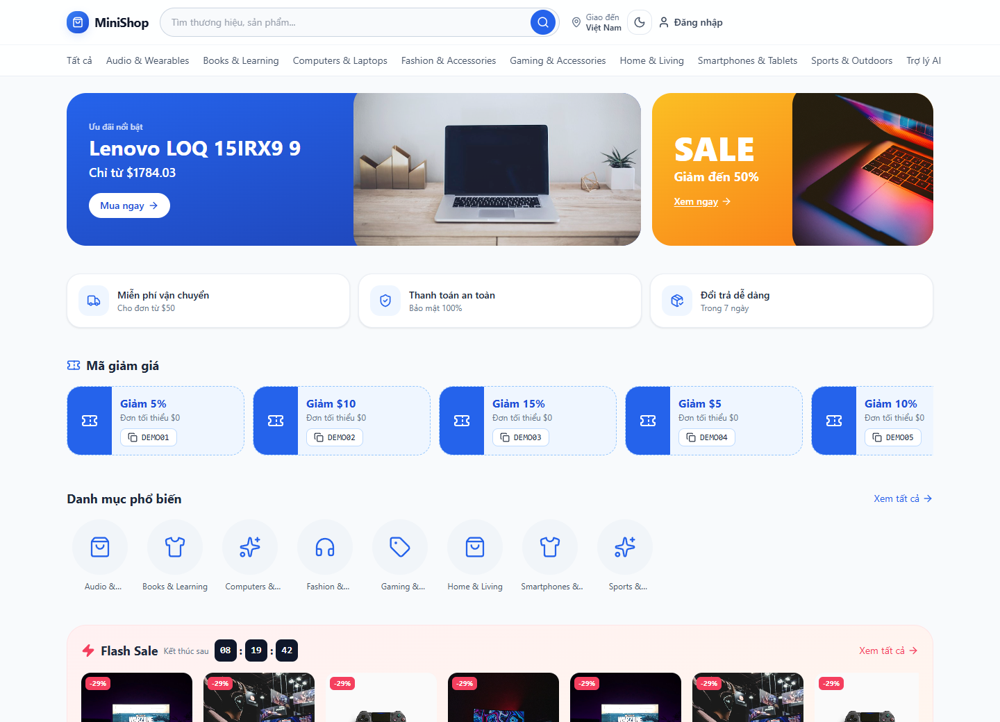

Hình 1. Trang chủ Marketplace hiển thị catalog và danh mục từ SQL Server.

#### Hình 2 Chi tiết sản phẩm, thuộc tính cấu trúc và sản phẩm tương tự.

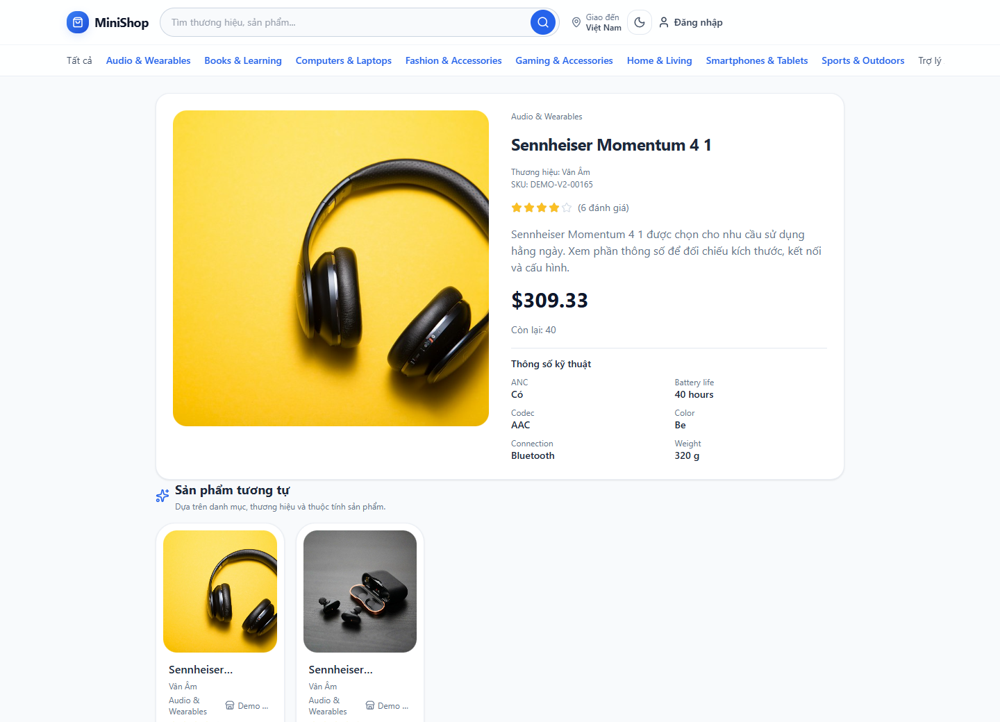

Hình 2. Chi tiết sản phẩm, thuộc tính cấu trúc và sản phẩm tương tự.

#### Hình 3 Khách hàng xem giỏ hàng hiện có, không tạo đơn mới trong lần nghiệm thu này.

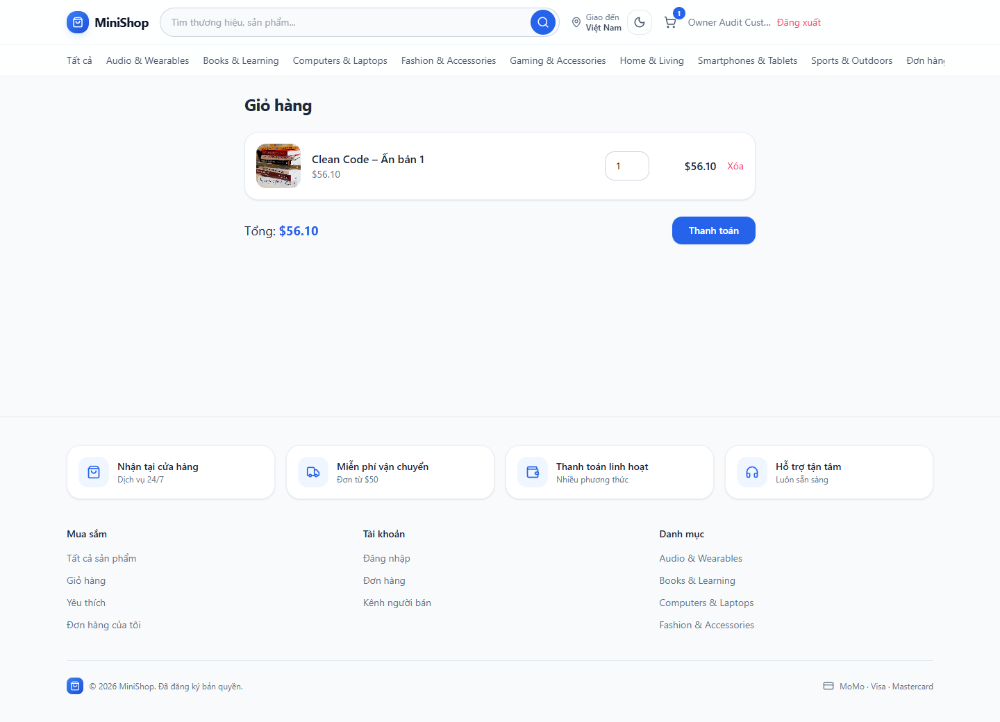

Hình 3. Khách hàng xem giỏ hàng hiện có, không tạo đơn mới trong lần nghiệm thu này.

#### Hình 4 Giao diện checkout và lựa chọn thanh toán của khách hàng.

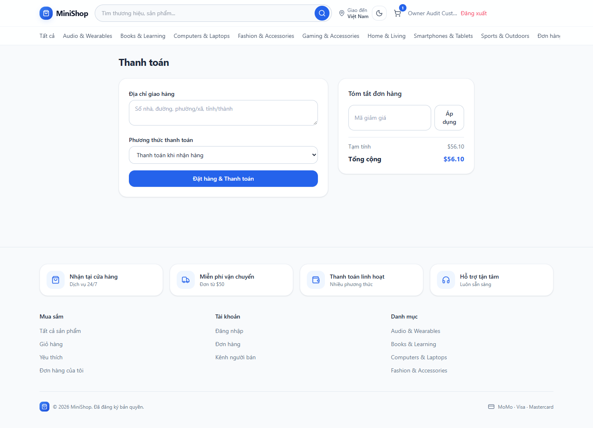

Hình 4. Giao diện checkout và lựa chọn thanh toán của khách hàng.

#### Hình 5 Khách hàng xem lịch sử đơn hàng và trạng thái hoàn tiền.

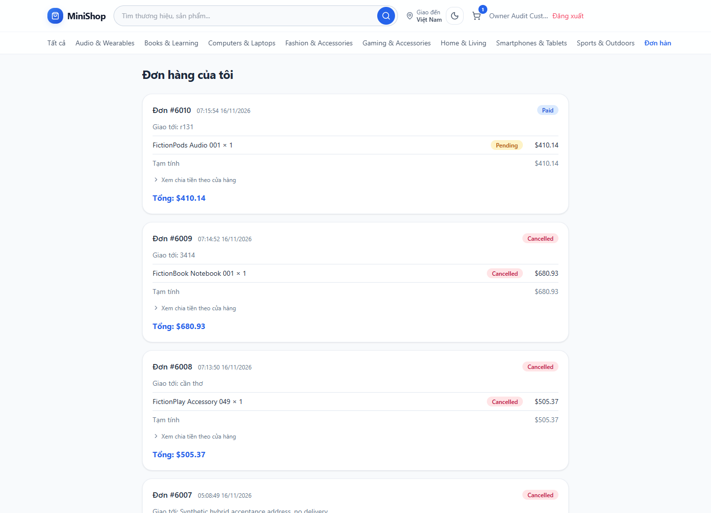

Hình 5. Khách hàng xem lịch sử đơn hàng và trạng thái hoàn tiền.

#### Hình 6 Dashboard người bán được giới hạn theo SellerId.

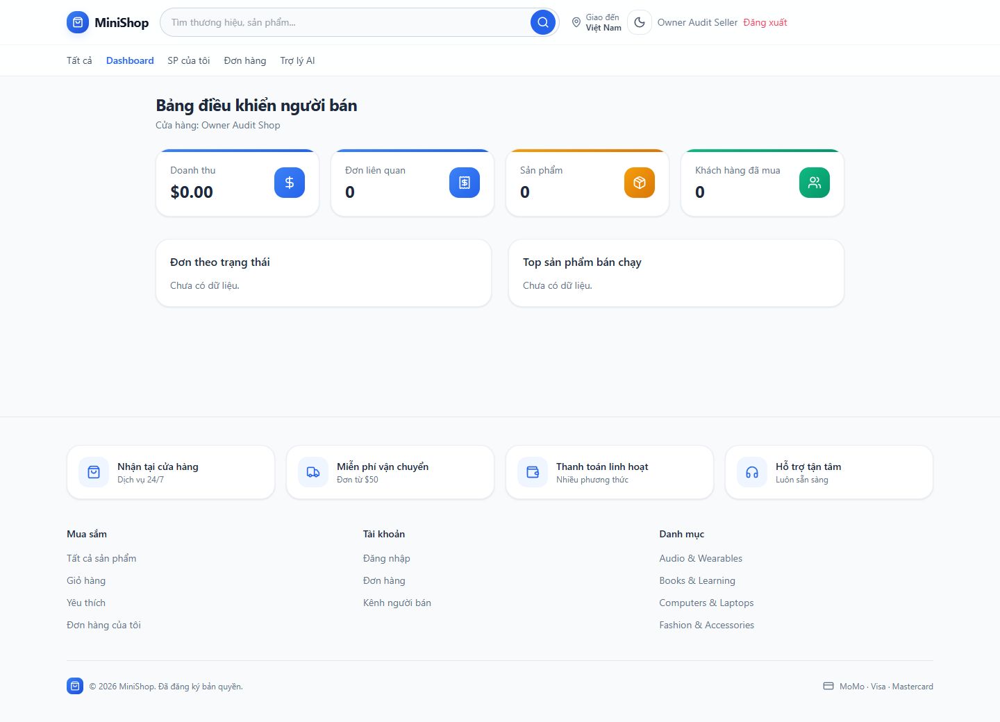

Hình 6. Dashboard người bán được giới hạn theo SellerId.

#### Hình 7 Người bán chỉ thấy các mặt hàng thuộc phạm vi cửa hàng mình.

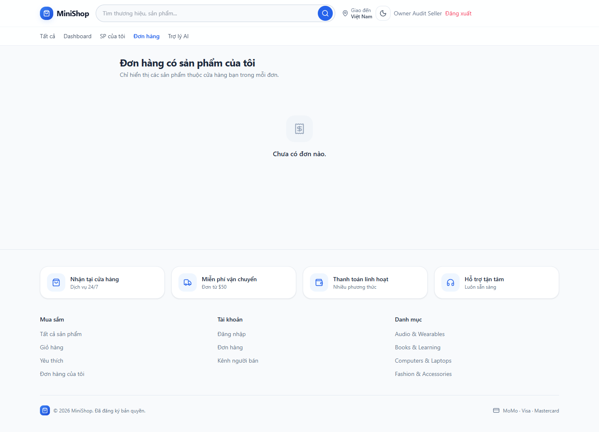

Hình 7. Người bán chỉ thấy các mặt hàng thuộc phạm vi cửa hàng mình.

#### Hình 8 Dashboard quản trị: Đơn theo trạng thái và Top sản phẩm bán chạy nhận kết quả từ hai Stored Procedures.

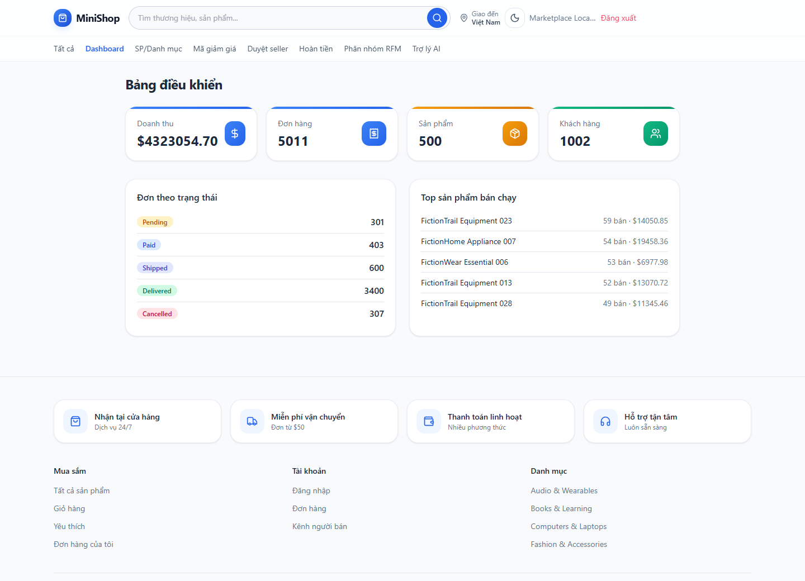

Hình 8. Dashboard quản trị: Đơn theo trạng thái và Top sản phẩm bán chạy nhận kết quả từ hai Stored Procedures.

#### Hình 9 Quản trị catalog, thương hiệu và thuộc tính sản phẩm.

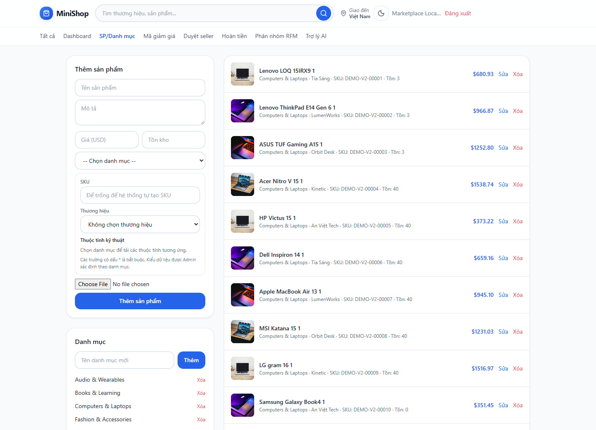

Hình 9. Quản trị catalog, thương hiệu và thuộc tính sản phẩm.

#### Hình 10 Quản trị theo dõi yêu cầu hoàn tiền và trạng thái xử lý.

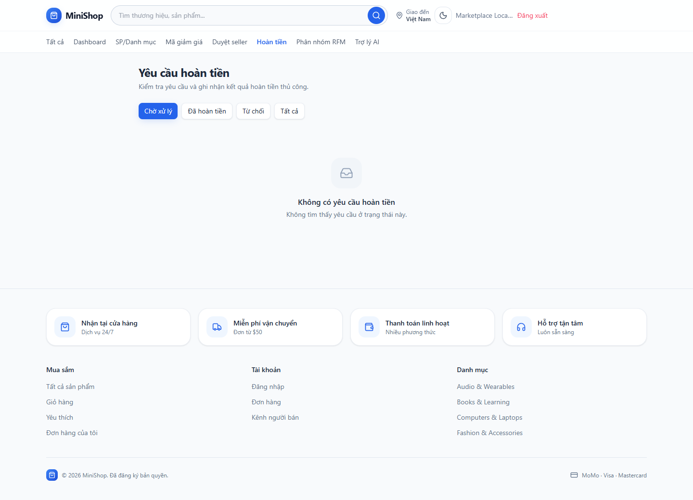

Hình 10. Quản trị theo dõi yêu cầu hoàn tiền và trạng thái xử lý.

#### Hình 11 Phân loại khách hàng theo Recency, Frequency và Monetary từ giao dịch hợp lệ.

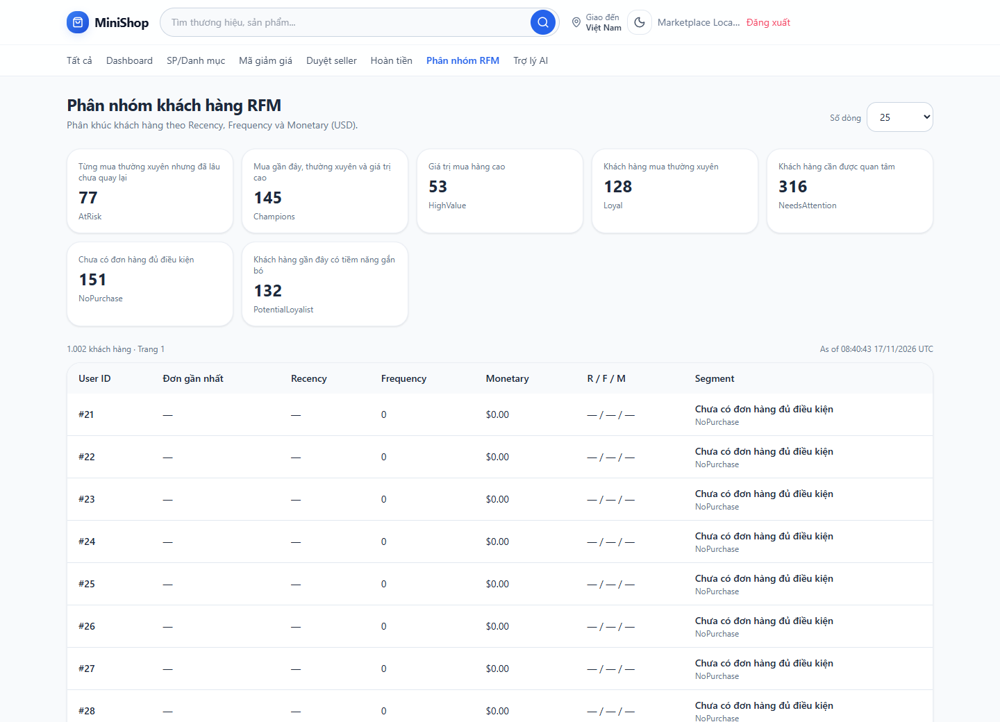

Hình 11. Phân loại khách hàng theo Recency, Frequency và Monetary từ giao dịch hợp lệ.

#### Hình 12 Shopping Assistant trả lời từ catalog SQL, giữ điều kiện giá trên 1000 USD và công bố chế độ retrieval thực tế.

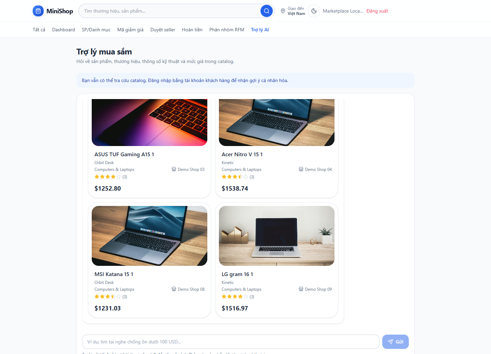

Hình 12. Shopping Assistant trả lời từ catalog SQL, giữ điều kiện giá trên 1000 USD và công bố chế độ retrieval thực tế.

Tài khoản Seller dùng cho ảnh đang có phạm vi dữ liệu rỗng; giao diện thể hiện đúng trạng thái không có đơn. Dashboard Admin có dữ liệu thật từ database phát triển: 5.011 đơn hàng, 500 sản phẩm và 1.002 khách hàng. Tên trong top bán chạy lấy từ snapshot OrderItem, có thể khác tên catalog hiện tại vì lịch sử giao dịch được giữ nguyên.

## 4. Thiết kế cơ sở dữ liệu

Database hiện có 16 bảng nghiệp vụ:

1. Users
2. Categories
3. Products
4. Brands
5. AttributeDefinitions
6. ProductAttributeValues
7. Carts
8. CartItems
9. Orders
10. OrderItems
11. Payments
12. Refunds
13. Reviews
14. WishlistItems
15. Coupons
16. RefreshTokens

Các quan hệ chính:

- Một User có thể đặt nhiều Order; một Order có nhiều OrderItem.
- Product liên kết Category, Seller và Brand; Product có thể có nhiều ProductAttributeValue.
- Cart thuộc một User và có nhiều CartItem.
- Order có Payment theo quan hệ một-một và có thể có Refund.
- OrderItem lưu snapshot tên sản phẩm, người bán và đơn giá tại thời điểm đặt hàng để bảo toàn lịch sử giao dịch.

Toàn bộ schema được quản lý bằng EF Core migrations. Có 16 migrations trong baseline trước phần bổ sung phục vụ yêu cầu Stored Procedure; migration mới 20261117130000_AddDashboardStoredProcedures chỉ tạo Stored Procedure và cập nhật trigger, không thêm bảng/cột hoặc thay đổi dữ liệu nghiệp vụ. Migration này đã được áp dụng trước trên disposable LocalDB bằng SQL Server provider, sau đó trên clone đang dùng sau backup COPY_ONLY WITH CHECKSUM và RESTORE VERIFYONLY. Lịch sử hiện có 17 migration; EF không phát hiện pending model changes.

### 4.1 Khóa và ràng buộc toàn vẹn

- Primary Key xác định duy nhất mỗi bản ghi.
- Foreign Key bảo vệ quan hệ giữa User, Product, Order, OrderItem, Payment, Refund và các bảng liên quan.
- Unique indexes bảo vệ các business key như SKU, email, cart theo user, item trong cart, payment theo order/provider reference và review theo product/user.
- CHECK constraints giới hạn các giá trị như giá và tồn kho không âm, số lượng dương, rating từ 1 đến 5 và trạng thái nằm trong miền enum hợp lệ.
- RowVersion được dùng cho optimistic concurrency ở các thực thể có nguy cơ cập nhật đồng thời như Product, Coupon, Order, OrderItem, Payment và Refund.

## 5. CRUD và truy vấn có tham số

Các thao tác Create, Read, Update, Delete được thực hiện qua service và Entity Framework Core:

- Product: tạo, xem, cập nhật và xóa theo quyền Admin/Seller.
- Cart: thêm, xem, cập nhật số lượng và xóa sản phẩm trong giỏ.
- Order: checkout, xem lịch sử, hủy và theo dõi trạng thái.
- Catalog: quản lý Category, Brand và typed attributes.
- Admin: quản lý seller, refund và dữ liệu dashboard.

Các truy vấn LINQ được EF Core chuyển thành SQL có tham số. Không ghép trực tiếp dữ liệu người dùng vào chuỗi SQL. Stored Procedure cũng nhận @SellerId và @Take qua parameter thay vì nối chuỗi.

## 6. Index và tối ưu truy vấn

Index được đặt theo khóa tra cứu, quan hệ và ràng buộc nghiệp vụ. Một số ví dụ:

| Index | Mục đích |
|---|---|
| Unique Products.Sku | Tra cứu SKU và ngăn SKU trùng |
| Products.CategoryId, SellerId, BrandId | Lọc catalog theo danh mục, người bán và thương hiệu |
| Unique Carts.UserId | Mỗi khách hàng có tối đa một giỏ hàng |
| Unique CartItems(CartId, ProductId) | Không tạo dòng sản phẩm trùng trong cùng giỏ |
| Orders.UserId | Lấy đơn theo khách hàng |
| OrderItems.OrderId, ProductId, SellerId | Tra cứu dòng đơn theo đơn, sản phẩm và seller |
| Unique Payments.OrderId | Một payment record cho mỗi order |
| Unique filtered Payments(ProviderKey, TransactionId) và (ProviderKey, ProviderReference) | Chống ghi nhận trùng giao dịch/provider reference |
| Unique Reviews(ProductId, UserId) | Một khách hàng không tạo review trùng cho cùng sản phẩm |
| ProductAttributeValues(AttributeDefinitionId, ValueNumber/ValueBoolean) | Lọc sản phẩm theo thuộc tính kiểu số/boolean |

Index vừa phục vụ hiệu năng vừa thực thi các quy tắc duy nhất. Không kết luận một index cụ thể làm truy vấn nhanh hơn nếu chưa có execution plan hoặc phép đo IO/time tương ứng.

## 7. Transaction và concurrency

### 7.1 Checkout

Checkout cập nhật tồn kho, tạo Order và OrderItem, áp dụng coupon và cập nhật giỏ hàng trong cùng một lần SaveChangesAsync. Với SQL Server provider, EF Core sử dụng transaction cho một lần SaveChanges để các thay đổi cùng thành công hoặc cùng rollback.

### 7.2 Refund

Các bước cập nhật Refund, Payment, Order, OrderItem và tồn kho trong thao tác hoàn tiền được lưu cùng một transaction database. Nếu một thay đổi thất bại, transaction rollback để không để lại trạng thái một phần.

### 7.3 Payment gateway

Gọi dịch vụ thanh toán bên ngoài không thể nằm trong transaction SQL Server. Ứng dụng dùng payment attempt, callback verification và reconciliation để xử lý kết quả từ provider. Vì vậy không mô tả transaction database như thể nó bao phủ cả hệ thống thanh toán bên ngoài.

### 7.4 Optimistic concurrency

RowVersion giúp phát hiện hai request đồng thời sửa cùng một dữ liệu. Ứng dụng xử lý conflict thay vì âm thầm ghi đè cập nhật trước đó.

## 8. Stored Procedures

Migration 20261117130000_AddDashboardStoredProcedures bổ sung hai Stored Procedure phục vụ dashboard. Chúng được gọi thực tế từ DashboardService thông qua DashboardStoredProcedureQueries.

### 8.1 dbo.usp_GetOrderStatusSummary

Tham số:
- @SellerId INT = NULL: NULL lấy dữ liệu toàn sàn; có giá trị thì chỉ thống kê các đơn có OrderItem thuộc seller đó.

Kết quả: trạng thái đơn hàng và số lượng đơn tương ứng. EXISTS được sử dụng để tránh đếm trùng một đơn có nhiều OrderItem của cùng seller.

Nơi áp dụng: Admin Dashboard và Seller Dashboard, khu vực “Đơn theo trạng thái”.

### 8.2 dbo.usp_GetTopSellingProducts

Tham số:
- @SellerId INT = NULL: phạm vi toàn sàn hoặc một seller.
- @Take INT = 5: số sản phẩm trả về; giá trị được giới hạn an toàn trong procedure.

Kết quả: ProductId, ProductName, UnitsSold và Revenue.

Quy tắc dữ liệu:
- Chỉ lấy Order có trạng thái Paid, Shipped hoặc Delivered.
- Payment phải Completed.
- Loại payment demo và payment đang yêu cầu reconciliation.
- Loại OrderItem đã Cancelled.
- Có thể giới hạn theo seller.

Nơi áp dụng: Admin Dashboard và Seller Dashboard, khu vực “Top sản phẩm bán chạy”.

Hai procedure chỉ đọc dữ liệu, không thay thế transaction hoặc business logic Checkout/Payment/Refund trong application service.

## 9. Trigger

Trigger: dbo.TR_OrderItems_ProtectSnapshot.

Trigger được áp dụng trên bảng OrderItems cho ba sự kiện INSERT, UPDATE và DELETE.

| Sự kiện | Quy tắc |
|---|---|
| INSERT | Snapshot SellerId, ProductName và UnitPrice của OrderItem phải khớp Product tại thời điểm tạo |
| UPDATE | Không cho sửa OrderId, ProductId, SellerId, ProductName, UnitPrice và Quantity; trạng thái fulfillment vẫn được cập nhật |
| DELETE | Không cho xóa vật lý OrderItem để bảo toàn lịch sử giao dịch và snapshot của đơn hàng |

Khi vi phạm, trigger phát sinh lỗi SQL để hủy thao tác. Các thay đổi trạng thái giao hàng hợp lệ không bị chặn vì Status không thuộc nhóm trường snapshot bất biến.

Trigger được quản lý trong migration để có thể áp dụng lại trên database mới và rollback có kiểm soát.

## 10. Khai thác dữ liệu bằng AI

- AI Shopping Assistant: kết hợp semantic retrieval và lexical retrieval trên catalog; dữ liệu giá, tồn kho và thuộc tính phải lấy từ nguồn SQL/evidence, không để mô hình tự suy đoán.
- Recommendation: xếp hạng sản phẩm theo tín hiệu phù hợp và điều kiện eligibility của Marketplace.
- RFM: phân nhóm khách hàng theo Recency, Frequency và Monetary; dùng giao dịch hợp lệ, canonical currency USD và quyền truy cập Admin.

AI là lớp khai thác dữ liệu trên database hiện hữu, không thay thế SQL Server làm nguồn dữ liệu chuẩn.

## 11. Kiểm thử và nghiệm thu

Ngày nghiệm thu: 17 tháng 11 năm 2026. Hai lỗi thực tế được sửa: projection DTO của fallback dashboard không dịch được trên provider non-SQL Server; assertion của test SQL vẫn chờ Paid sau khi service đã chuyển đơn sang Shipped. Không sửa VNPAY, Payment, Refund hoặc các bảng/cột.

| Hạng mục | Kết quả đã quan sát |
|---|---|
| Backend build | PASS, 0 warning và 0 error |
| Backend test thường | 369 PASS, 0 FAIL, 3 SQL opt-in SKIP |
| Frontend | 10 test PASS; production build và lint PASS |
| Disposable LocalDB | 1 test SQL course PASS sau sửa; chạy đủ 17 migration bằng Microsoft.EntityFrameworkCore.SqlServer |
| Stored Procedures | Cả hai được gọi qua DashboardService và API dashboard; bộ đếm SQL procedure có 4 lần thực thi mỗi procedure trong browser smoke |
| Trigger INSERT | INSERT hợp lệ được lưu; INSERT sai ProductName với SellerId hợp lệ bị SQL 51006, không thêm dòng |
| Trigger UPDATE | Snapshot bị sửa bị từ chối; cập nhật fulfillment Shipped hợp lệ được chấp nhận |
| Trigger DELETE | Xóa OrderItem bị từ chối; dòng lịch sử vẫn tồn tại |
| DB đang dùng | 17 migration; pending model changes false; hai procedure tồn tại; trigger đăng ký đủ INSERT UPDATE DELETE |
| Bảo toàn dữ liệu | 16 bảng nghiệp vụ giữ nguyên row count và SHA-256 qua migration; không reset, reseed hoặc import |
| Browser thật | 12 ảnh Guest Customer Seller Admin AI; 0 page error; dashboard HTTP 200 |
| AI shopping | HTTP 200, lọc đúng 4 sản phẩm trên 1000 USD; lúc chụp sử dụng lexical-warming và fallback, không tuyên bố Gemini generation PASS |

Backup trước migration được giữ riêng ngoài Git. SHA-256: `a27e191bc2c0026796dc68e4722f7cb0110ba454c77ab0b8b615af43b622921f`. RESTORE VERIFYONLY WITH CHECKSUM báo backup set hợp lệ. Không restore hoặc ghi đè database đang dùng.

Hai test SQL lifecycle khác không được chạy lại trong lượt này. Kết quả 3/3 PASS ngày 16 tháng 11 là evidence lịch sử trên commit 7073342, không thay cho kết quả của HEAD hiện tại. Test SQL course mới đã thực sự chạy trên database disposable và fixture đã được dọn sau khi lưu kết quả. Việc đăng nhập qua UI có thể tạo RefreshTokens theo nghiệp vụ; không thay đổi đơn hàng, số tiền, tồn kho hay dữ liệu catalog.

## 12. Giới hạn hiện tại

- VNPAY status query còn trường hợp trả mã 99 cần được ghi nhận đúng theo kết quả runtime.
- Hoàn tiền qua gateway bên ngoài chưa tự động hoàn tất; hệ thống quản lý refund state và reconciliation, việc chuyển tiền bên ngoài cần được xác nhận theo quy trình hiện tại.
- Gemini có thể bị quota/rate-limit; retrieval cần giữ fallback an toàn.
- Ứng dụng hiện hướng đến demo local, không tuyên bố production-ready.

## 13. Kết luận

Marketplace áp dụng SQL Server cho dữ liệu người dùng, catalog, giỏ hàng, đơn hàng, thanh toán, hoàn tiền và đánh giá. EF Core quản lý CRUD và migration; index, foreign key, unique/check constraints bảo vệ tính toàn vẹn; transaction và RowVersion bảo vệ các luồng cập nhật quan trọng. Hai Stored Procedure phục vụ dashboard và trigger bảo vệ snapshot OrderItem. Các chức năng AI khai thác catalog và giao dịch hiện hữu để hỗ trợ tìm kiếm, đề xuất và phân loại khách hàng.

Báo cáo này kèm 12 ảnh giao diện thật, kết quả kiểm thử và minh chứng hai procedure cùng ba sự kiện trigger trên SQL Server. Ứng dụng có thể mở để trình diễn ở http://localhost:5173; Swagger ở http://localhost:5215/swagger. AI vẫn công bố đúng chế độ fallback khi provider chưa sẵn sàng.

## 14. Hướng dẫn trình diễn local

API sử dụng file cấu hình local riêng và kết nối tường minh tới `(localdb)\MarketplaceRefundDev20261113 / ECommerceDb_Dev`. Không để key trong repository. Khởi động bằng `scripts/Start-LocalApi.ps1` với `-LocalConfigPath` trỏ tới file riêng và `-DotnetPath` trỏ SDK .NET 9 hiện có. Trong thư mục client, chạy `npm run dev -- --host localhost --port 5173 --strictPort`.

Mở localhost bằng tài khoản phát triển đã có để trình diễn lần lượt catalog, giỏ hàng, checkout, đơn hàng, seller dashboard, admin dashboard, refund, RFM và trợ lý mua sắm. Không cần chạy seeder hoặc migration lại khi khởi động. PR số 8 giữ trạng thái Draft, chưa merge.
