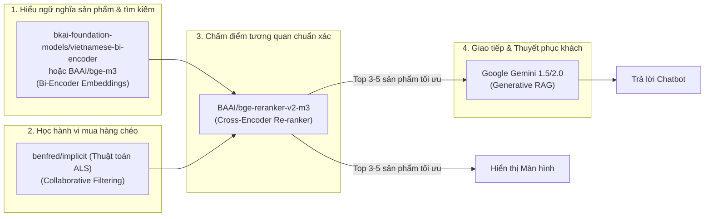
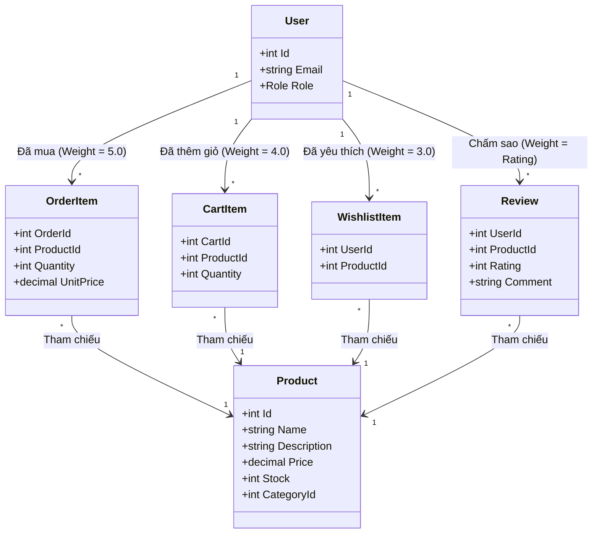

# Kiến Trúc Recommendation Kiểu Netflix Ứng Dụng Cho MiniShop

Hệ thống gợi ý của Netflix nổi tiếng là sự kết hợp đa tầng (Multi-algorithm approach), giải quyết đồng thời bài toán: sở thích lâu dài của người dùng, hành vi tìm kiếm tức thời, và phân phối kết quả đồng bộ trên cả **Giao diện Màn hình (On-Screen Carousels)** lẫn **Trợ lý Ảo (ChatBot RAG)**.

Tài liệu này phân tích chi tiết:
1. **Kiến trúc Kênh đôi (Dual-Channel)**: Màn hình hiển thị gợi ý & Chatbot cùng chia sẻ chung một nguồn dữ liệu (Shared State).
2. **Bản đồ dữ liệu tín hiệu** từ database MiniShop.
3. **Ý nghĩa và vai trò cụ thể của từng model AI có sẵn** trong quy trình.
4. **Quy trình 2 giai đoạn** (Candidate Retrieval & Ranking).

---

## 1. Kiến Trúc Kênh Đôi: Màn Hình Gợi Ý & ChatBot Cùng Thừa Hưởng Dữ Liệu

Theo đúng yêu cầu nghiệp vụ:
> *"Hệ thống sẽ đọc theo cách người dùng tìm hàng/mua sắm và hệ thống sẽ cho gợi ý ở trên màn hình, còn chatbot thì cũng sẽ được hưởng thông tin đó."*

Hệ thống được thiết kế theo mô hình **Single Source of Truth (Một nguồn dữ liệu chung)**:

```mermaid
flowchart TD
    subgraph User Actions [Hành vi của người dùng]
        A1[Lịch sử Mua sắm: OrderItem]
        A2[Yêu thích & Giỏ hàng: Wishlist & Cart]
        A3[Tìm kiếm thời gian thực: Search Query]
    end

    subgraph Recommendation Engine [Bộ máy gợi ý phong cách Netflix]
        M1[Model Bi-Encoder / ALS: Khai phá ứng viên Top 30]
        M2[Model Re-ranker: Chấm điểm & Xếp hạng Top 5]
        M1 --> M2
        SharedState[(Active Recommendation State\nDanh sách sản phẩm được đề xuất tối ưu)]
        M2 --> SharedState
    end

    UserActions --> Recommendation Engine

    subgraph Channel 1: Giao diện Màn hình [On-Screen UI]
        C1[Hàng ngang Carousel: Gợi ý cho bạn]
        C2[Hàng ngang Carousel: Vì bạn đã mua X]
        C3[Danh sách sản phẩm tương tự khi click xem chi tiết]
    end

    subgraph Channel 2: ChatBot RAG [AI Shopping Assistant]
        B1[Đọc Shared Recommendation State vào bộ nhớ Context]
        B2[Hiểu ngay khách hàng đang nhìn thấy gợi ý gì trên màn hình]
        B3[Gemini LLM tư vấn trực tiếp theo đúng danh mục được gợi ý]
    end

    SharedState -->|Hiển thị trực quan| Channel 1
    SharedState -->|Kế thừa ngữ cảnh| Channel 2
```

### Lợi ích của cơ chế này:
1. **Trải nghiệm nhất quán (Seamless UX)**: Khi khách nhìn thấy sản phẩm A được gợi ý trên màn hình và mở ChatBot hỏi: *"Món trên màn hình dùng có tốt không?"* hoặc *"Tư vấn thêm về mấy món đang gợi ý cho tôi"*, Chatbot **ngay lập tức biết chính xác** danh sách sản phẩm đó mà không cần khách phải giải thích lại.
2. **Không trùng lặp tính toán**: Bộ máy gợi ý (Recommendation Engine) chỉ chạy 1 lần để tính toán ra danh sách sản phẩm tiềm năng, sau đó cả giao diện UI lẫn Chatbot đều cùng dùng chung kết quả này.

---

## 2. Ý Nghĩa & Vai Trò Cụ Thể Của Các Model Có Sẵn

Dưới đây là ý nghĩa cốt lõi của từng mô hình pre-trained (từ Hugging Face & Open Source) và vị trí chính xác của chúng trong hệ thống:



### 2.1. Model `bkai-foundation-models/vietnamese-bi-encoder`
* **Link**: [https://huggingface.co/bkai-foundation-models/vietnamese-bi-encoder](https://huggingface.co/bkai-foundation-models/vietnamese-bi-encoder)
* **Ý nghĩa / Bản chất**: Đây là "Người phiên dịch ngữ nghĩa Tiếng Việt". Thay vì tìm kiếm máy móc bằng từ khóa khớp từng chữ (nếu khách gõ *"tai nghe không dây"* mà sản phẩm ghi *"tai nghe bluetooth"* thì tìm kiếm truyền thống sẽ thất bại), model này ánh xạ cả câu tìm kiếm và sản phẩm thành các tọa độ vector 768 chiều.
* **Vai trò trong hệ thống**:
  - Đọc hành vi tìm kiếm của người dùng trong phiên hiện tại.
  - So khớp ngữ nghĩa giữa câu hỏi của khách với toàn bộ sản phẩm trong kho để đưa vào danh sách gợi ý sơ bộ.

### 2.2. Model `BAAI/bge-m3` (Tùy chọn đa ngôn ngữ nâng cao)
* **Link**: [https://huggingface.co/BAAI/bge-m3](https://huggingface.co/BAAI/bge-m3)
* **Ý nghĩa / Bản chất**: Đây là mô hình biểu diễn văn bản đa năng mạnh nhất hiện nay (SOTA). Nó hiểu được cả văn bản dài (mô tả chi tiết sản phẩm) và câu truy vấn ngắn, đặc biệt xuất sắc khi người dùng gõ lẫn lộn tiếng Anh và tiếng Việt (ví dụ: *"tai nghe gaming over-ear chống ồn giá rẻ"*).
* **Vai trò trong hệ thống**: Tạo vector nhúng chuẩn cho kho sản phẩm và lưu vào bộ nhớ đệm (Cache/Vector Index).

### 2.3. Thuật toán Collaborative Filtering ALS (`benfred/implicit`)
* **Link**: [https://github.com/benfred/implicit](https://github.com/benfred/implicit)
* **Ý nghĩa / Bản chất**: Đây là "Bộ não phát hiện hành vi số đông" (tương tự thuật toán lõi đoạt giải Netflix Prize). Nó không quan tâm tên sản phẩm viết gì, mà chỉ quan sát ma trận: **Ai đã mua món gì**. Từ đó nó phát hiện ra quy luật ngầm: *"85% người mua Bàn phím cơ cũng sẽ mua thêm Kê tay hoặc Keycap trong vòng 14 ngày"*.
* **Vai trò trong hệ thống**:
  - Tạo hàng gợi ý trên màn hình: **"Khách hàng mua món này cũng mua..."** hoặc **"Vì bạn đã mua [Tên sản phẩm cũ]"**.
  - Bổ sung các sản phẩm đồng mua vào danh sách ứng viên cho Chatbot.

### 2.4. Model `BAAI/bge-reranker-v2-m3`
* **Link**: [https://huggingface.co/BAAI/bge-reranker-v2-m3](https://huggingface.co/BAAI/bge-reranker-v2-m3)
* **Ý nghĩa / Bản chất**: Đây là "Vị giám khảo chấm điểm khắt khe" (Cross-Encoder). Trong khi Bi-Encoder chỉ tính khoảng cách vector nhanh (độ chính xác tương đối), Re-ranker nhận trực tiếp cặp `(Sở thích/Câu hỏi của khách, Sản phẩm ứng viên)` và so sánh từng từ để chấm điểm tương quan từ 0.0 đến 1.0.
* **Vai trò trong hệ thống**: Nhận 30 sản phẩm từ Bi-Encoder và ALS, lọc và sắp xếp lại để chọn ra đúng **Top 5 sản phẩm hoàn hảo nhất** để vừa chiếu lên màn hình, vừa chuyển cho Chatbot.

### 2.5. Model `sentence-transformers/all-MiniLM-L6-v2` (Tùy chọn siêu nhẹ)
* **Link**: [https://huggingface.co/sentence-transformers/all-MiniLM-L6-v2](https://huggingface.co/sentence-transformers/all-MiniLM-L6-v2)
* **Ý nghĩa / Bản chất**: Kích thước siêu nhỏ (~90MB). Có thể nạp thẳng vào trình duyệt bằng `@xenova/transformers` hoặc nhúng vào file `.onnx` trong C# ASP.NET Core.
* **Vai trò trong hệ thống**: Phù hợp khi bạn muốn hệ thống tự tính toán gợi ý ngay trên client của khách mà không tốn chi phí server.

### 2.6. Google Gemini (Mô hình Ngôn ngữ Sinh - Generative LLM)
* **Ý nghĩa / Bản chất**: "Chuyên viên tư vấn bán hàng cá nhân". Nó không cần phải tự đi tìm trong 10,000 sản phẩm; nó nhận danh sách Top 3-5 sản phẩm đã được chọn lọc từ các model gợi ý bên trên và diễn giải chúng bằng ngôn từ tự nhiên, thuyết phục, lịch sự.

---

## 3. Bản Đồ Dữ Liệu Tín Hiệu (User Signals Mapping)

Trong MiniShop, hệ thống thu thập các hành vi mua sắm và tìm kiếm qua các bảng dữ liệu sau:



### Bảng trọng số tương tác (Interaction Score Matrix)

Hệ thống tính điểm sở thích $I(u, p)$ của người dùng $u$ đối với sản phẩm $p$:

$$I(u, p) = w_{order} \times \mathbb{I}_{order} + w_{cart} \times \mathbb{I}_{cart} + w_{wish} \times \mathbb{I}_{wish} + (Rating - 3)$$

- **Đã mua thành công (`OrderItem`)**: Trọng số cao nhất (+5.0 điểm).
- **Đã thêm vào giỏ hàng (`CartItem`)**: Ý định mua rất cao (+4.0 điểm).
- **Đã lưu vào danh sách yêu thích (`WishlistItem`)**: Sở thích dài hạn (+3.0 điểm).
- **Đánh giá (`Review`)**: 5 sao (+2 điểm), 4 sao (+1 điểm), 1-2 sao (-2 điểm - loại trừ gợi ý).
- **Hành vi tìm kiếm trong phiên (Search Query Session)**: Trọng số tức thời (+3.5 điểm).

---

## 4. Quy Trình 2 Giai Đoạn (Two-Stage Pipeline) Chi Tiết

```mermaid
graph TD
    subgraph Stage 1: Candidate Generation / Retrieval (Thu gom ứng viên)
        A[Kho sản phẩm MiniShop: Product] --> B1[Collaborative Filtering: Lấy từ lịch sử OrderItem]
        A --> B2[Bi-Encoder: Lấy từ từ khóa tìm kiếm gần nhất]
        A --> B3[Content-based: Lấy sản phẩm cùng danh mục trong Wishlist]
        B1 --> C[Tập hợp 30 - 50 sản phẩm ứng viên]
        B2 --> C
        B3 --> C
    end

    subgraph Stage 2: Scoring & Re-ranking (Chấm điểm & Lọc nghiệp vụ)
        C --> D1[BGE-Reranker: Chấm điểm tương quan với User Profile]
        D1 --> D2[Lọc nghiệp vụ: Loại hàng hết kho Stock <= 0]
        D2 --> D3[Khử trùng lặp: Không gợi ý lại sản phẩm vừa mua hôm qua]
        D3 --> E[Top 4 - 6 Sản phẩm tối ưu nhất]
    end

    subgraph Distribution: Phân Phối Kênh Đôi
        E --> UI[1. Hiển thị Lên Màn Hình: Carousel 'Gợi ý cho bạn']
        E --> ChatContext[2. Lưu vào ChatBot Context: Shared State]
        ChatContext --> Gemini[Gemini LLM sinh lời tư vấn tương ứng]
    end
```

---

## 5. Các Kịch Bản Gợi Ý Màn Hình & ChatBot Thực Tế

### Kịch bản 1: Khách hàng đã có lịch sử mua hàng
- **Hành vi**: Khách từng mua *"Bàn phím cơ DareU"* trong bảng `OrderItem`.
- **Hiển thị trên màn hình**: 
  - Một banner/carousel với tiêu đề: *"Vì bạn đã mua Bàn phím cơ DareU"* hiển thị các sản phẩm: Kê tay bàn phím, Chuột công thái học, Lót chuột cỡ lớn.
- **Phản ứng của ChatBot**:
  - Khi khách mở ChatBot, bot chào: *"Chào bạn! Mình thấy bạn đang sở hữu Bàn phím cơ DareU. MiniShop đang có kê tay và chuột không dây rất hợp với bàn làm việc của bạn ở ngay trên màn hình đấy, bạn có muốn mình tư vấn chi tiết không?"*.

### Kịch bản 2: Khách hàng tìm kiếm trong phiên (Real-time Search)
- **Hành vi**: Khách gõ tìm kiếm *"sách lập trình c#"* trên thanh tìm kiếm của sàn.
- **Hiển thị trên màn hình**: 
  - Ngoài kết quả tìm kiếm chính, hàng gợi ý bên dưới xuất hiện thêm: *"Sách Clean Code"*, *"The Pragmatic Programmer"*.
- **Phản ứng của ChatBot**:
  - Context của ChatBot lập tức được cập nhật: `current_interest = "sách lập trình"`.
  - Khi khách hỏi ChatBot: *"Có sách nào hay cho người mới bắt đầu không?"*, ChatBot lập tức bám sát danh sách đang gợi ý trên màn hình để trả lời.

### Kịch bản 3: Khách mới hoàn toàn (Cold-Start)
- **Hành vi**: Khách vãng lai chưa đăng nhập, chưa mua gì.
- **Hiển thị trên màn hình**: Hàng sản phẩm *"Bán chạy nhất tuần qua"* (Top đơn hàng nhiều nhất trong `OrderItem`) và *"Được đánh giá 5 sao nhiều nhất"*.
- **Phản ứng của ChatBot**: Gợi ý các sản phẩm tiêu biểu của từng danh mục nổi bật (Công nghệ, Sách, Thời trang).
