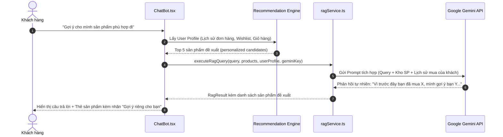

# Hướng Dẫn Tích Hợp Recommendation Vào ChatBot RAG Hiện Tại

Tài liệu này hướng dẫn cách kết nối hệ thống gợi ý sản phẩm cá nhân hóa vào ChatBot RAG (`ragService.ts` và `ChatBot.tsx`) mà **không làm thay đổi hay phá vỡ logic sẵn có**.

---

## 1. Hiện Trạng ChatBot RAG Của MiniShop

Trong codebase hiện tại:
- **`client/src/services/ragService.ts`**:
  - `fetchMarketProducts()`: Tải toàn bộ sản phẩm trên sàn thông qua API `/api/products`.
  - `executeRagQuery()`: Tìm kiếm theo từ khóa chuẩn hóa (`normalizeText`), từ điển đồng nghĩa (`SYNONYM_MAP`), bóc tách điều kiện giá (`extractPriceConstraint`), và gửi prompt tới Gemini nếu người dùng nhập API Key.
- **`client/src/components/ChatBot.tsx`**:
  - Quản lý giao diện hộp chat, hiển thị danh sách tin nhắn `ChatMessage`, danh sách sản phẩm khớp (`matchedProducts`), sản phẩm na ná (`similarProducts`), nút "Thêm vào giỏ".

---

## 2. Điểm Nâng Cấp: "Recommendation-Aware RAG"

Hiện tại, RAG chỉ phản hồi dựa trên **câu hỏi tức thời** của người dùng. Để đạt đẳng cấp gợi ý kiểu Netflix, Chatbot cần có thêm **Bối Cảnh Người Dùng (User Profile Context)**.



---

## 3. Các Bước Tích Hợp Chi Tiết (Từng Bước Cụ Thể)

### Bước 1: Khai báo Interface ngữ cảnh người dùng (`UserShoppingProfile`)

Trong file định nghĩa kiểu dữ liệu (hoặc ngay trong service mở rộng):

```typescript
export interface UserShoppingProfile {
  userId?: number;
  userName?: string;
  recentPurchasedProductIds: number[];    // Lấy từ /api/orders
  recentPurchasedNames: string[];        // Tên các món đã mua
  wishlistProductIds: number[];          // Lấy từ /api/wishlist
  cartProductIds: number[];              // Lấy từ /api/cart
  favoriteCategories: string[];          // Danh mục mua nhiều nhất
  averageSpend: number;                  // Mức chi tiêu trung bình
}
```

### Bước 2: Hàm tổng hợp hồ sơ người dùng (`buildUserProfile`)

Không cần sửa API backend, bạn có thể tận dụng các hook/API client sẵn có trong `client/src/api/client.ts`:

```typescript
// Ví dụ hàm thu thập context (chỉ chạy khi user đã đăng nhập)
export async function getCurrentUserProfile(): Promise<UserShoppingProfile | null> {
  try {
    const token = localStorage.getItem("minishop_token");
    if (!token) return null; // Guest user -> bỏ qua

    // Gọi song song các API hiện có của MiniShop
    const [ordersRes, wishlistRes, cartRes] = await Promise.allSettled([
      fetch("/api/orders/my-orders", { headers: { credentials: "include", Authorization: `Bearer ${token}` } }),
      fetch("/api/wishlist", { credentials: "include", headers: { Authorization: `Bearer ${token}` } }),
      fetch("/api/cart", { credentials: "include", headers: { Authorization: `Bearer ${token}` } })
    ]);

    // Trích xuất các ProductId và tên sản phẩm để làm tín hiệu gợi ý...
    // (Xem chi tiết file mẫu trong thư mục sample-code/)
  } catch (error) {
    console.warn("Không thể tải hồ sơ người dùng cho Recommendation:", error);
    return null;
  }
}
```

### Bước 3: Nâng cấp Prompt gửi cho Gemini LLM trong `ragService.ts`

Trong hàm gọi Gemini API, thêm phần bối cảnh mua sắm vào System Instruction:

```typescript
// Cấu trúc Prompt nâng cao kết hợp Recommendation
const promptWithPersonalization = `
Bạn là Trợ lý Mua sắm Cá nhân Thông minh của sàn thương mại điện tử MiniShop.

THÔNG TIN KHÁCH HÀNG:
- Tên khách hàng: ${userProfile?.userName || "Quý khách"}
- Các sản phẩm khách ĐÃ TỪNG MUA gần đây: ${userProfile?.recentPurchasedNames.join(", ") || "Chưa có lịch sử mua hàng"}
- Danh mục khách hay quan tâm: ${userProfile?.favoriteCategories.join(", ") || "Đa dạng"}

KHO SẢN PHẨM HIỆN CÓ TRÊN SÀN (Kèm ID, Tên, Giá, Danh mục):
${productsContext}

CÂU HỎI HIỆN TẠI CỦA KHÁCH HÀNG:
"${userQuery}"

NHIỆM VỤ CỦA BẠN:
1. Trả lời trực tiếp câu hỏi của khách hàng.
2. Nếu khách hàng nhờ gợi ý, hãy khéo léo liên hệ với sở thích / các món họ từng mua (theo phong cách gợi ý thông minh của Netflix: "Vì bạn đã sở hữu sản phẩm X, sản phẩm Y sẽ là mảnh ghép hoàn hảo...").
3. Chỉ gợi ý các sản phẩm THỰC SỰ CÓ trong kho dữ liệu được cung cấp ở trên.
4. Trình bày ngắn gọn, lịch sự, thân thiện, dùng biểu tượng cảm xúc (emoji) phù hợp.
`;
```

### Bước 4: Mở rộng UI Chatbot (`ChatBot.tsx`) để hiển thị nhãn gợi ý

Trong component hiển thị sản phẩm, thêm một badge trực quan:
- 🌟 **"Gợi ý tương tự món bạn đã mua"**
- 🔥 **"Phù hợp nhất với sở thích của bạn"**
- Kèm nút hành động nhanh: `[🛒 Thêm vào giỏ]` và `[👁️ Xem chi tiết]`.

---

## 4. Kiểm Thử Kịch Bản (Use Case Walkthrough)

| Kịch bản | Khách hàng hỏi | Hành vi Chatbot thông thường | Hành vi Chatbot tích hợp Recommendation (Netflix-style) |
|----------|----------------|------------------------------|----------------------------------------------------------|
| **Khách đã mua Laptop** | *"Có phụ kiện gì hay không?"* | Liệt kê ngẫu nhiên phụ kiện có trong shop. | *"Vì bạn vừa mua Laptop tuần trước, mình gợi ý Chuột không dây Ergonomic và Bàn phím cơ đang có sẵn tại TechZone để góc làm việc của bạn trọn vẹn nhất!"* |
| **Khách yêu thích Sách** | *"Gợi ý mình vài món thư giãn cuối tuần"* | Tìm từ khóa "thư giãn" không ra kết quả. | *"Nhận thấy bạn rất yêu thích các đầu sách công nghệ trong Wishlist, shop gợi ý thêm cuốn 'The Pragmatic Programmer' vừa về hàng ạ!"* |
| **Khách mới (Guest)** | *"Sản phẩm nào hot nhất?"* | Báo lỗi hoặc tìm theo chữ "hot". | Tự động lấy Top 3 sản phẩm có nhiều lượt mua nhất từ bảng `OrderItem` và đánh giá cao nhất. |
